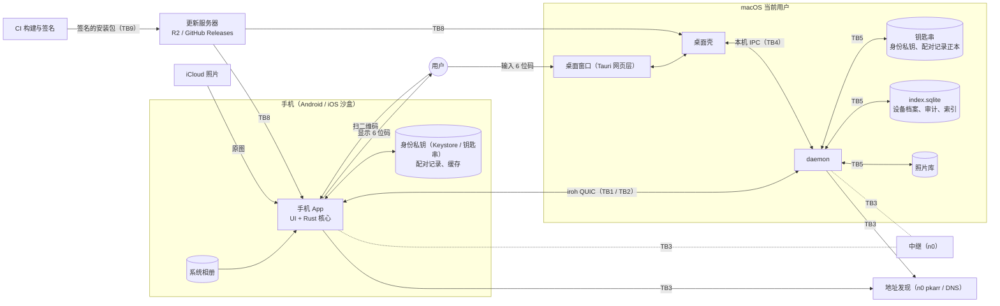

# P-Pass 威胁模型

本文说明 P-Pass 防什么、不防什么、信任边界在哪里，以及出事以后怎么止损。

- 适用平台：macOS、Android、iOS。
- 来源：#1116 的威胁建模审查。

只报告漏洞、不打算参与修复的话，请走 GitHub 的私密漏洞上报：仓库 Security 页 → Report a vulnerability。不要在公开 issue 里写可被利用的细节。

## 1. 方法

| 部分 | 对照 | 覆盖 |
|---|---|---|
| 整体 | 数据流图加信任边界，每条边界按 STRIDE 逐项判断（冒充、篡改、抵赖、信息泄露、拒绝服务、提权） | 9 条信任边界 |
| 手机端 | OWASP MAS Testing Profiles 的 MAS-L1、MAS-L2、MAS-P 三档，按 MASWE 逐条对照，Android 和 iOS 各做一遍 | 每个平台 63 条 |
| 桌面网页层 | Tauri 官方安全文档：CSP、capabilities、命令权限、asset 协议、devtools、updater | — |
| daemon 与本机 IPC | OWASP ASVS 5.0 中适用的章节：认证、会话、访问控制、输入校验、资源上限、日志、配置 | — |
| 更新链路 | TUF 威胁模型：任意安装、回滚、冻结、混合与匹配、超大数据、慢速下载、密钥泄露 | 桌面与 Android 各两个通道 |
| 构建与发布 | SLSA Build track | — |
| 配对 | PAKE（RFC 9382 SPAKE2）的标准性质，以及 SAS 短认证串比对 | — |

不做 MAS-R（抗逆向与防篡改加固）：P-Pass 开源，攻击者可以直接读源码，这类防护的收益很低。

术语：MAS 的档位一律写全称 MAS-L1 / MAS-L2 / MAS-P，避免和卡片验证级别 L0~L3（`docs/AGENT_PROTOCOL.md`）混淆。本项目自己的存储分级叫「机密 / 受保护配置 / 开放」：

- **机密**：设备身份私钥、配对记录正本、库位置正本。存放在系统钥匙串或 Keystore。
- **受保护配置**：只允许签过名的 P-Pass 程序写入。手机端由 App 沙盒保证。
- **开放**：照片，以普通文件存放在照片库目录。

## 2. 要保护的东西

1. **照片原图与缩略图**：在手机上，以及电脑的照片库里。
2. **设备身份私钥**：每台设备一把。私钥被拿走，就等于这台设备可以被冒充：冒充手机能读整个照片库，冒充电脑能骗手机把照片发给它。
3. **配对记录**：电脑认哪些手机、各自是什么角色。
4. **更新签名私钥**：决定什么样的安装包能装到用户设备上。
5. **元数据**：设备名、文件名、IP 地址、上线时间。

## 3. 防什么、不防什么

**防**

- **网络上的任何人**：
  - 设备之间只通过 iroh QUIC 通信，端到端加密，对端身份就是对方的公钥（NodeId）。
  - 中继只转发密文。
- **未配对的设备**：
  - 只有在电脑显示配对二维码期间才能接入配对流程，其他时间在握手阶段就被拒绝，电脑不读取它的任何请求。
  - 配对入口有资源上限。
- **看到二维码的旁观者，以及伪造的二维码**：
  - 配对必须在电脑上输入手机显示的 6 位验证码。验证码基于 SPAKE2，并带密钥确认，输错一次本单即作废（#1118）。
  - 手机只把「已经和自己完成过配对」的电脑当作老电脑，扫到陌生电脑的码一律走验证码（#1145）。
- **已经被移除的设备**：在电脑上移除后立即失去访问权限，正在进行的传输被中止，两端清理残留数据（#1119）。
- **手机上的其他 App**：
  - 身份私钥存在系统 Keystore 或钥匙串里，iOS 上仅限本设备，不进备份（#1106、#1107）。
  - Android 只导出启动入口和开机广播，不接收外部参数。
  - iOS 没有 URL scheme，也没有 Universal Link。
- **手机系统本身不可信的情况（root 或越狱）**：按 MAS-L2 的假设逐条评估过。
- **同一台 Mac 上的其他程序**：
  - daemon 按对端的代码签名认人，并按程序限定能调用哪些方法。
  - 身份私钥和配对记录正本放在只有签名 daemon 能读写的钥匙串条目里（#1109、#1115）。
- **桌面网页层被注入脚本**：严格 CSP、`freezePrototype`、命令逐条放行、正式包关闭开发者工具（#1120）。
- **更新服务器被攻破**：
  - 安装包必须通过本通道公钥的 minisign 验签，test 和正式通道各用一把密钥（#1121）。
  - macOS 安装前还要核对团队签名和包内版本号，防止被降级到旧版本（#1147）。
  - Android 借系统的版本号检查防降级（#1146）。

**不防（以及理由）**

- **能以当前用户身份在电脑上执行任意代码的程序**：同用户的代码执行已经超出消费级产品的防护范围，同类产品一般也不防。认不认某台设备只看钥匙串里的正本，不依赖照片库里的任何数据。
- **已配对设备在权限内做的事**：家庭场景下，已配对设备是用户自己授权的。设备档案和审计用于事后查看，不防抵赖。
- **中继和地址发现服务能看到的元数据**：目前使用 iroh 官方 n0 的公共中继和地址发现服务。它们能看到双方 NodeId、源 IP、连接时间和流量大小，看不到内容。自建中继在里程碑 #6 处理。
- **逆向和二次打包**：见 §1，不做 MAS-R。

## 4. 数据流与信任边界

| 编号 | 信任边界 | 跨越的数据 |
|---|---|---|
| TB1 | 已配对手机 ↔ daemon | 控制面请求、原图、订阅推送 |
| TB2 | 未配对对端 ↔ daemon（配对入口），以及人眼带外通道 | hello、配对请求、二维码、6 位码 |
| TB3 | 设备 ↔ 中继与地址发现 | 加密的 QUIC 包；NodeId 对应的中继地址 |
| TB4 | 本机其他程序、网页层 ↔ daemon 本机 IPC | 管理操作：批准配对、移除设备、库设置 |
| TB5 | daemon ↔ 本机存储（macOS） | 钥匙串正本、设备档案与审计、照片文件 |
| TB6 | 手机 App ↔ 手机系统、其他 App | 身份私钥、配对记录、缓存、日志 |
| TB7 | iOS App ↔ iCloud 照片 | 原图 |
| TB8 | 客户端 ↔ 更新服务器 | 更新清单、安装包 |
| TB9 | CI 构建与签名环境 ↔ 第三方依赖、仓库 | 源码、依赖、签名私钥 |

## 5. 审查结论

- 每条信任边界都按 STRIDE 逐项判断过；手机端按 MASWE 在 Android 和 iOS 上各逐条对照过一遍。
- 审查中发现、需要尽快修复的问题，均已在发布前修复。
- 其余改进按纵深防御排期，不公开逐项清单；涉及安全的问题在修复发布之前不公开细节。

## 6. 对应关系

#12 的各卡与信任边界的对应关系：

| 卡 | 对应 |
|---|---|
| #1106 / #1107 | TB6；MASWE-0003、MASWE-0006 |
| #1109 / #1110 / #1112 / #1115 | TB4、TB5 |
| #1117 | TB1、TB5（档案与配对记录分开存放） |
| #1118 / #1145 | TB2；配对协议（PAKE / SAS） |
| #1119 | TB1（撤销） |
| #1120 | TB4（网页层） |
| #1121 / #1146 / #1147 / #728 | TB8、TB9；TUF |
| #1122 | TB2（配对入口与资源上限）；日志隐私 |
| #1124 / #1126 | TB1、TB6（Android 改用与 iOS 相同的 Rust 传输核心） |

## 7. 出事以后怎么止损

- **手机丢了，或者怀疑手机被别人控制**：
  - 在电脑上打开设备列表，移除这台手机。
  - 移除后它立刻失去访问权限，正在进行的传输被中止。
  - 之后如果要用同一台手机，需要重新配对。
- **怀疑有不认识的设备配对过**：在电脑的设备列表和审计记录里查看配对历史，把不认识的设备移除。
- **怀疑电脑被入侵**：
  - 在手机上断开与这台电脑的配对。
  - 已经备份到电脑上的照片无法撤回。
  - 处理干净之后，重新安装 P-Pass 会生成新的设备身份，再与手机重新配对。
- **更新签名私钥泄露**：按 `docs/runbook/update-signing-keys.md` 的轮换流程处理：用旧密钥签发一个携带新公钥的过渡版本。
- **发现漏洞**：通过 GitHub 私密漏洞上报提交。修复发布之前不公开细节。

## 8. 何时更新本文

以下几类改动需要同步更新本文和对应的矩阵结论：

- 新增或改变信任边界，例如新的网络入口、新的本机进程、新的第三方服务；
- 改变身份与配对模型；
- 改变更新链路或发布流程；
- 新增手机平台能力，例如扩展、深链接、WebView。
